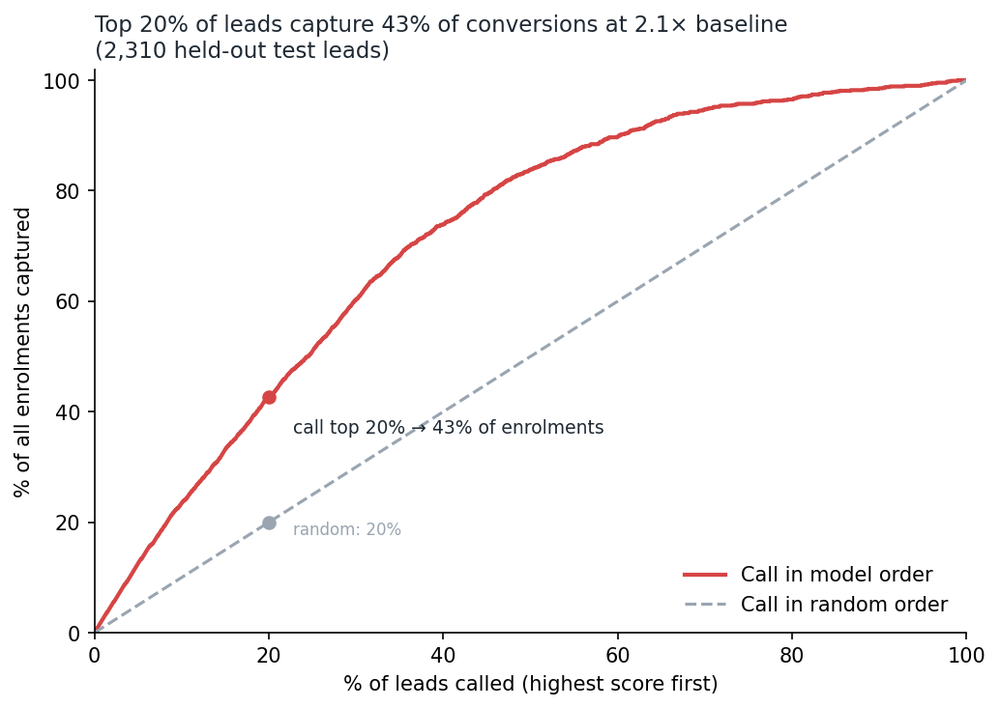
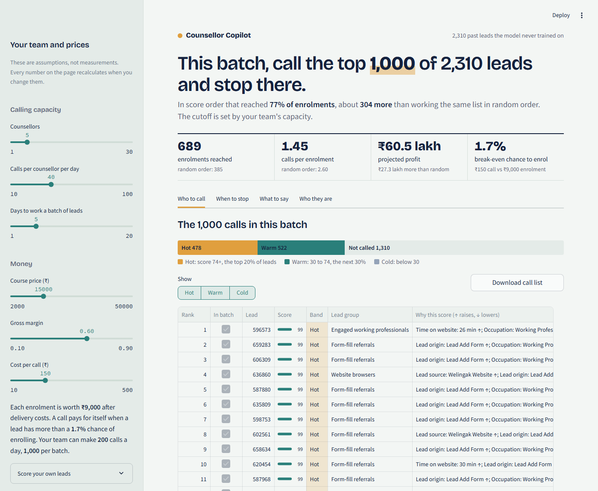
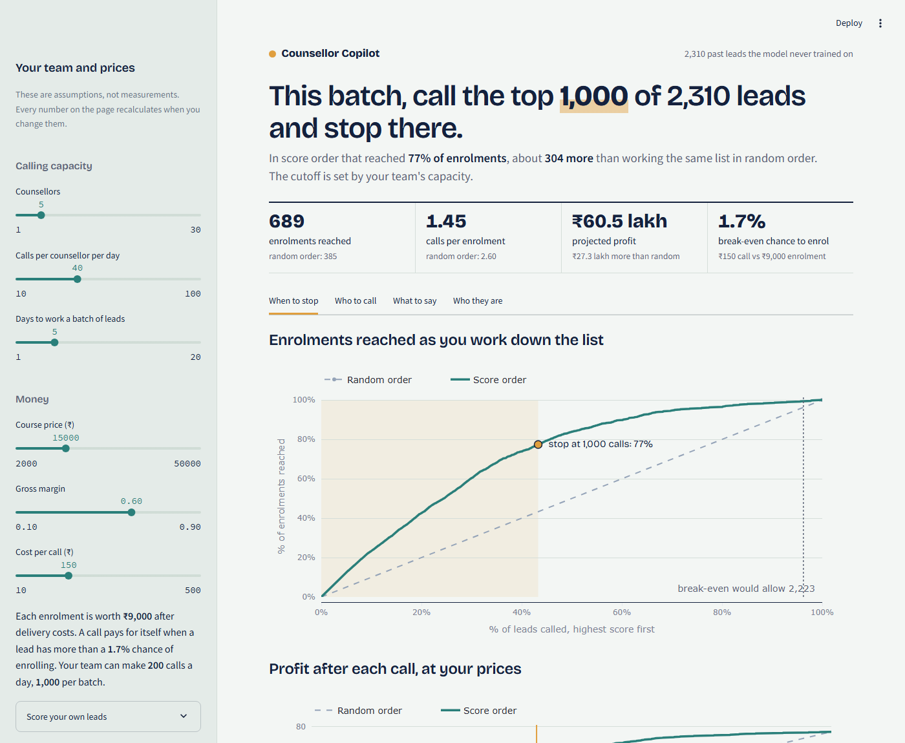
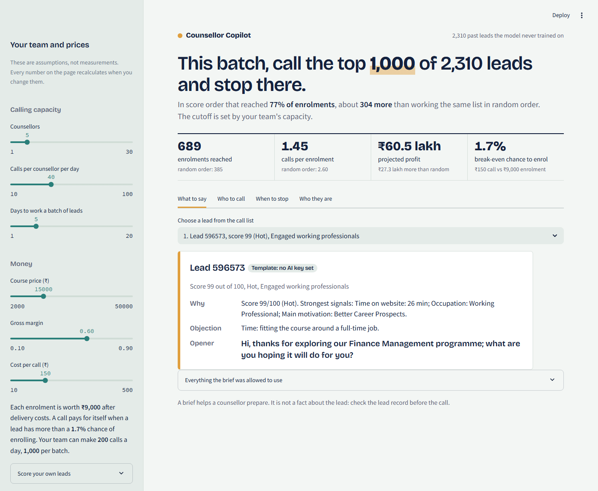
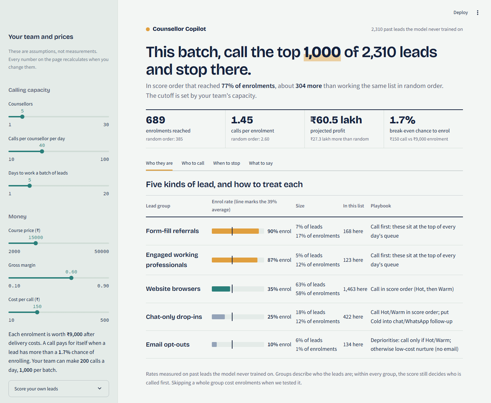

# Counsellor Copilot

**Counsellors can't call every lead. Who to call, when to stop, what to say.**

A lead-scoring and call-planning tool for an edtech admissions team, built on the Kaggle
"Lead Scoring (X Education)" dataset (9,240 leads, 38.5% enrolled). Every number below comes from the
notebooks in this repo, run on **2,310 held-out test leads** the model never saw.

---

## 1. Headline result

> **Top 20% of leads capture 43% of conversions at 2.1× baseline.**

Calling in score order takes **1.22 calls per enrolment** in the top 20%, against **2.60** in random order.



With an assumed capacity of 1,000 calls for those 2,310 leads (5 counsellors × 40 calls/day × 5 days),
score order reaches **77%** of enrolments vs **43%** in random order: about **304 more enrolments**
(₹27.3 lakh at assumed prices).

## 2. Three recommendations

| # | Action | Owner | Evidence | Expected effect |
|---|---|---|---|---|
| 1 | Work every day's call list in lead-score order and stop at capacity; never call in arrival or random order. | Sales ops (queue) + counsellors | With 1,000 calls for 2,310 test leads, score order reaches 77% of enrolments vs 43% at random. | Would add ~304 enrolments per 2,310 leads (~13 per 100 leads) with the same headcount; ₹27.3 lakh at assumed prices. |
| 2 | Shift acquisition budget toward form-fill channels (Lead Add Form: Reference, Welingak) and test fixes for Olark Chat before scaling it. | Marketing | Lead Add Form leads convert at 92% but are 8% of volume; Olark Chat is 19% of volume at 26%. | More high-intent leads per rupee, *if quality holds at higher volume*. Validate with a small budget-shift test. |
| 3 | Treat counsellor capacity, not call cost, as the lever: price one more counsellor against the leads just below today's cutoff. | Sales ops / management | A call breaks even at 1.7% conversion (assumed prices); the next 200 leads below the 1,000-call cutoff still convert at 35%. | One extra counsellor (200 calls per batch) would reach ~70 more enrolments, ₹6.0 lakh before salary (assumed prices). |

A persona-based alternative was **tested and rejected**. Moving "Email opt-outs" and "Chat-only drop-ins"
to nurture unless Hot *lost* 17 enrolments at the same 1,000 calls (672 vs 689), because the score already
ranks those leads correctly. Personas explain who the leads are; the score decides who gets called.

One-page version for a sales manager: [reports/business_summary.pdf](reports/business_summary.pdf).

## 3. Leakage audit: why the honest model scores lower

9 columns are filled in *after* a counsellor contacts the lead: `Tags`, `Lead Quality`, `Lead Profile`,
`Last Activity`, `Last Notable Activity` and the four `Asymmetrique` scores. They were dropped, along with
the two ID columns. The full column-by-column audit is in [reports/leakage_audit.md](reports/leakage_audit.md).

| Same logistic regression, same test leads | Test AUC | Precision @ top 20% |
|---|---|---|
| **Honest** (only columns known when the lead arrives) | **0.852** | **82.3%** |
| Leaky (+ post-contact columns) | 0.976 | 98.5% |

9 of the leaky model's 10 strongest features are counsellor notes (e.g. `Tags=Will revert after reading
the email`). Those notes record the outcome of a call, so they can't exist for a new lead.

**Kept, but flagged as unclear:**
- **Web activity** (visits, time, page views): counted at export time, so it may include visits after first contact. Removing it costs 0.085 AUC.
- **Occupation + "What matters most"**: they may be filled in by a counsellor. Removing them costs 0.035 AUC.
- **Do Not Email**: the opt-out may happen after contact. Removing it costs 0.002 AUC.

## 4. When to stop: profit cutoff sensitivity

EV per call = P(convert) × price × margin − cost per call; call in score order while EV > 0, capped at capacity.
**All prices and costs are assumptions** (margin 60%); test set of 2,310 leads. Profit differences are in ₹ lakh.

| Price | Cost/call | Break-even P | EV>0: % leads called | EV>0: % enrolments | EV>0 vs call everyone | Capacity (1,000 calls): vs random |
|---|---|---|---|---|---|---|
| ₹5,000 | ₹50 | 1.7% | 96% | 99% | −0.1 | +9.1 |
| ₹5,000 | ₹150 | 5.0% | 87% | 98% | −0.0 | +9.1 |
| ₹5,000 | ₹300 | 10.0% | 73% | 96% | +0.6 | +9.1 |
| ₹15,000 | ₹50 | 0.6% | 98% | 100% | −0.2 | +27.3 |
| ₹15,000 | ₹150 | 1.7% | 96% | 99% | −0.3 | +27.3 |
| ₹15,000 | ₹300 | 3.3% | 92% | 99% | −0.4 | +27.3 |
| ₹30,000 | ₹50 | 0.3% | 100% | 100% | +0.0 | +54.7 |
| ₹30,000 | ₹150 | 0.8% | 97% | 100% | −0.6 | +54.7 |
| ₹30,000 | ₹300 | 1.7% | 96% | 99% | −0.6 | +54.7 |

**Reading it:** a call costs little next to an enrolment, so with unlimited counsellors it pays to call almost
everyone. The model's value is in deciding **which** leads get limited counsellor time: +₹9.1 to +₹54.7 lakh
vs random order across the grid. Full tables: [reports/sensitivity.md](reports/sensitivity.md).

## 5. The app

| Who to call | When to stop |
|---|---|
|  |  |
| **What to say** | **Who they are** |
|  |  |

- **Header:** the week's plan in one sentence (how many leads to call, where to stop, what share of enrolments that reaches), with enrolments, calls per enrolment, projected profit and break-even underneath.
- **Sidebar:** your team (counsellors, calls per day, days per batch) and prices (course price, margin, cost per call). They are assumptions; every number recalculates. You can also upload new leads as CSV to score them.
- **Who to call:** a bar showing how the batch splits into Hot / Warm / Cold, then the ranked call list (score, band, lead group, top-3 reasons) with Do Not Call leads left out, and a download button.
- **When to stop:** enrolments reached and profit as you work down the list, with the stopping point marked and what one more counsellor would add.
- **What to say:** a call slip (why, likely objection, opening line). AI-written when `ANTHROPIC_API_KEY` is set; otherwise a deterministic template, labelled as such.
- **Who they are:** 5 lead groups compared on one table, with enrol rate against the average and a playbook for each.

### How to run

```bash
python -m venv .venv
.venv\Scripts\activate            # Windows  (macOS/Linux: source .venv/bin/activate)
pip install -r requirements.txt   # Python 3.11
# put the Kaggle file at data/Leads.csv
streamlit run app/streamlit_app.py
```

Rebuild everything from scratch:

```bash
cd notebooks
jupyter nbconvert --to notebook --execute --inplace 01_funnel_eda.ipynb 02_cleaning_leakage_audit.ipynb 03_model.ipynb 04_business_translation.ipynb
cd ..
python -m src.briefs --samples 20   # sample call briefs → reports/sample_briefs.md
python -m src.report                # one-page summary → reports/business_summary.md / .pdf
pytest
```

AI-written briefs are optional. Set `ANTHROPIC_API_KEY` in your environment (or in Streamlit secrets);
never commit it. The model name lives in `config.yaml` (`claude-haiku-5-5`). The sample briefs in this repo
were generated **without** a key, so they are all template briefs.

## 6. Method

- **Data:** "Select" treated as missing. Stratified 75/25 train/test split, `random_state=42`. Every cleaning rule (drops, rare categories, 99th-percentile caps) is learned on training leads only.
- **Model:** logistic regression vs LightGBM (20 Optuna trials), compared on top-20% precision with 5-fold cross-validation on training leads only. LightGBM gained +1.8 pp, below the +2.0 pp bar set beforehand, so the more explainable logistic regression was kept. *On the test set LightGBM would have scored 85.1% vs 82.0% precision@20%; choosing on test results would invalidate the test.*
- **Scores:** probabilities calibrated with isotonic regression (cross-validated). Lead score = probability × 100. Bands from training-score deciles: Hot ≥ 74 (top 20%), Warm ≥ 30, Cold below.
- **Explanations:** SHAP gives global drivers and each lead's top-3 drivers (one-hot levels summed back to their original column).
- **Economics and personas:** EV-per-call cutoff with a capacity cap and a price × cost sensitivity grid. Personas from KMeans, k = 5 chosen by silhouette (0.52), named and given playbooks by explicit rules.
- **Briefs:** the LLM sees only creation-time features and drivers. Code rejects any brief that cites a feature or number outside the input or uses post-contact language; one retry, then a template. 41 unit tests cover metrics, economics, cleaning, scoring and the brief validator.

Technical metrics (test set) are an appendix only: ROC AUC 0.851, PR-AUC 0.782, Brier 0.150 for the model
used ([reports/appendix_technical_metrics.csv](reports/appendix_technical_metrics.csv)).

## 7. Limitations

- **Retrospective, single-company data.** One edtech firm's past leads; results may not carry over to other products, markets or periods.
- **Assumed prices, margin, call cost and capacity.** All money figures are projections under the values in `config.yaml`.
- **No treatment data.** We don't know what would have happened if a lead had (not) been called. Results assume a called lead produces its recorded outcome, so there are **no causal or uplift claims**. The "more enrolments" figures are projections, not measured increases.
- **Unclear columns kept.** Web activity, occupation, motivation and email opt-out may partly reflect post-contact activity (see §3).
- **Calibration at the extremes.** The lowest-scored leads convert a little more often than predicted (87 test leads predicted 0.7%, actual 5.7%).
- **LLM briefs are aids, not facts.** They are checked against the lead's data, but a counsellor should still read the lead's record.

## Repo structure

```
counsellor-copilot/
├── config.yaml              # prices, call cost, capacity, model name (all assumptions)
├── src/                     # clean, model, metrics, economics, personas, briefs, eda, report
├── notebooks/01–04          # EDA → leakage audit → model → business translation
├── app/streamlit_app.py
├── models/                  # scorer, personas, scored leads, model card
├── reports/                 # figures, audit, sensitivity, personas, summary (.md/.pdf), sample briefs
└── tests/                   # pytest
```
