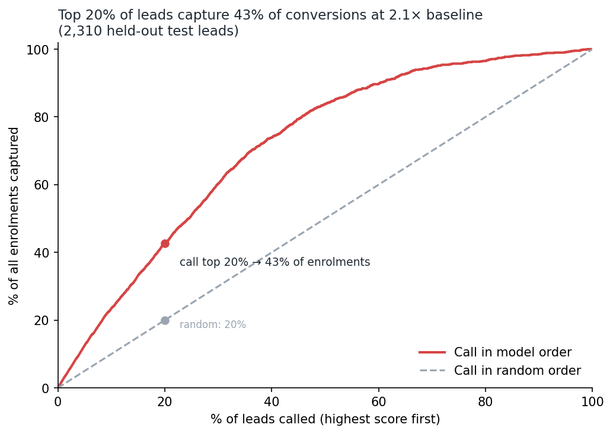

# Counsellor Copilot: who to call, when to stop, what to say

## Situation
Counsellors can't call every lead. In the historical data 38.5% of leads enrolled. At the assumed capacity, a team can call 1,000 of every 2,310 new leads in a week (43%), so the order of calls decides how many enrolments it reaches.

## Headline result
**Calling leads in score order, the top 20% of leads would capture 43% of enrolments at 2.1× the baseline rate.** With 1,000 calls, score order reaches 77% of enrolments vs 43% in random order: about 304 more enrolments (₹27.3 lakh at the assumed prices). Tested on 2,310 past leads the model never saw.

## Who the leads are
| Lead group | Share of leads | Enrol rate | Share of enrolments | Playbook |
|---|---|---|---|---|
| Form-fill referrals | 7% | 90% | 17% | Call first: these sit at the top of every day's queue |
| Engaged working professionals | 5% | 87% | 12% | Call first: these sit at the top of every day's queue |
| Website browsers | 63% | 35% | 58% | Call in score order (Hot, then Warm) |
| Chat-only drop-ins | 18% | 25% | 12% | Call Hot/Warm in score order; put Cold into chat/WhatsApp follow-up |
| Email opt-outs | 6% | 10% | 1% | Deprioritise: call only if Hot/Warm; otherwise low-cost nurture (no email) |

## Three recommendations
| # | Action | Owner | Evidence | Expected effect |
|---|---|---|---|---|
| 1 | Work every day's call list in lead-score order and stop at capacity (200 calls/day assumed); never call in arrival or random order. | Sales ops (queue) + counsellors | With 1,000 calls for 2,310 test leads, score order reaches 77% of enrolments vs 43% at random. | Would add ~304 enrolments per 2,310 leads (~13 per 100 leads) with the same headcount; ₹27.3 lakh at assumed prices. |
| 2 | Shift acquisition budget toward form-fill channels (Lead Add Form: Reference, Welingak) and test fixes for Olark Chat (qualifying questions in chat) before scaling it. | Marketing | Lead Add Form leads convert at 92% but are 8% of volume; Olark Chat is 19% of volume at 26%. | More high-intent leads per rupee of spend, if quality holds at higher volume (retrospective data: validate with a small budget-shift test). |
| 3 | Treat counsellor capacity, not call cost, as the lever: before cutting calls, price one more counsellor (or a longer calling window) against the leads just below today's cutoff. | Sales ops / sales management | A call breaks even at 1.7% conversion (assumed prices); the next 200 leads below the 1,000-call cutoff (ranks 1,001–1,200) still convert at 35%. | One extra counsellor (200 calls per batch) would reach ~70 more enrolments, ₹6.0 lakh before that counsellor's salary (assumed prices). |

*Assumptions (not measured): course price ₹15,000, gross margin 60%, ₹150 per call, 5 counsellors × 40 calls/day, 5 days to work a batch. Retrospective simulation on one company's past leads: projections, not measured uplift. Call briefs are aids, not facts.*
